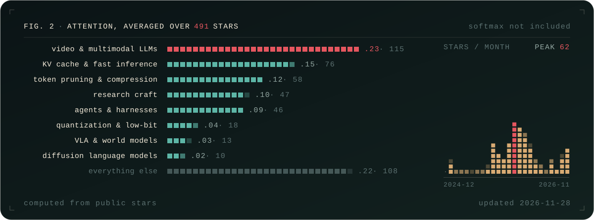
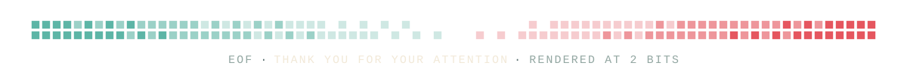

  <picture>
    <source media="(prefers-color-scheme: dark)" srcset="assets/hero-dark.svg">
    <source media="(prefers-color-scheme: light)" srcset="assets/hero-light.svg">
    
  </picture>

   
  I care about making multimodal models cheaper to run — 
  pruning the visual tokens nobody attends to, squeezing the KV cache, rounding weights to fewer bits — 
  and about the agents that get built on top of them.

  让多模态大模型跑得更省：剪掉没人看的视觉 token，压缩 KV cache，把权重舍入到更少的比特。

   
  <picture>
    <source media="(prefers-color-scheme: dark)" srcset="assets/triptych-dark.svg">
    <source media="(prefers-color-scheme: light)" srcset="assets/triptych-light.svg">
    
  </picture>

  <a href="https://github.com/Suzukitakeko?tab=stars">
    <picture>
      <source media="(prefers-color-scheme: dark)" srcset="assets/attention-dark.svg">
      <source media="(prefers-color-scheme: light)" srcset="assets/attention-light.svg">
      
    </picture>
  </a>

#### Patches upstream

<!-- patches:start -->
- `open` [elviscjn-cjn/antigravity-context-viewer#133](https://github.com/elviscjn-cjn/antigravity-context-viewer/pull/133) — test: fix cross-platform fixtures and isolate update tests
- `open` [elviscjn-cjn/antigravity-context-viewer#132](https://github.com/elviscjn-cjn/antigravity-context-viewer/pull/132) — fix(usage): align CLI session details with agy token totals
- `merged` [Lliar-liar/Daily-Omni#3](https://github.com/Lliar-liar/Daily-Omni/pull/3) — Fix Qwen2.5-Omni implementation bugs and optimize input order for &gt;10% performance boost
<!-- patches:end -->

   
  <picture>
    <source media="(prefers-color-scheme: dark)" srcset="assets/footer-dark.svg">
    <source media="(prefers-color-scheme: light)" srcset="assets/footer-light.svg">
    
  </picture>

  Every plate on this page is an SVG drawn by <a href="scripts/build.mjs">one small script</a> — no screenshots, no third-party widgets. Fig. 2 and the list above are recomputed from my public stars and pull requests once a day.

